<div dir="rtl" align="right">

# تخفیف گروهی هوشمند | Smart Bulk Discount

**افزونهٔ فارسی ووکامرس برای ساخت، زمان‌بندی و مدیریت تخفیف روی محصولات منتخب، دسته‌بندی‌ها یا تمام محصولات موجود فروشگاه.**

تخفیف درصدی یا مبلغ ثابت تعریف کنید، زمان شروع و پایان را با تقویم شمسی انتخاب کنید و پیشرفت کار را ببینید. پردازش در دسته‌های کوتاه انجام می‌شود و سرعت آن با منابع هاست تنظیم می‌شود. افزونه پیش از تغییر قیمت، اطلاعات قبلی را ذخیره می‌کند و در پایان کمپین آن‌ها را بازمی‌گرداند.

**نسخهٔ افزونه:** `1.2.0` · **سازنده:** Hooman Jamshidi · **مجوز:** `GPL-2.0-or-later`

[دانلود مستقیم افزونهٔ آمادهٔ نصب](https://github.com/hoomanjamshidi/Discount-Plugin/raw/refs/heads/main/dist/smart-bulk-discount-1.2.0.zip) · [راهنمای تصویری PDF](docs/راهنمای-نصب-تخفیف-گروهی.pdf) · [نسخهٔ HTML راهنما](docs/guide/guide.html) · [گزارش ساختار پروژه](graphify-out/GRAPH_REPORT.md)

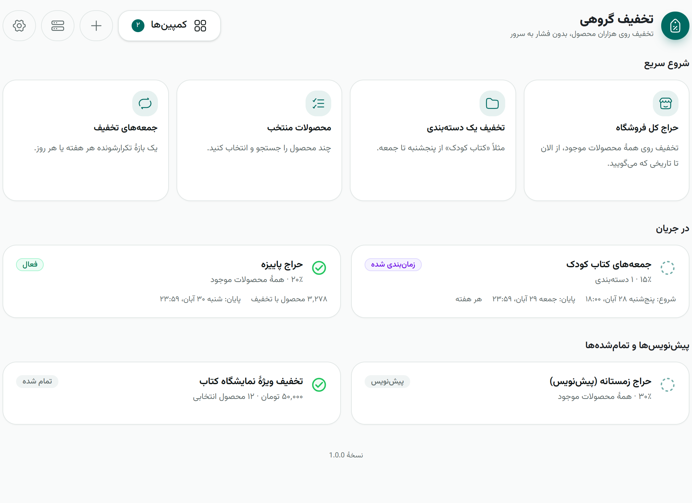

> تصاویر این صفحه از محیط آزمایشی پروژه تهیه شده‌اند؛ محصولات، آمار و زمان‌های آن‌ها نمونه‌اند. برخی تصاویر شمارهٔ نسخهٔ قدیمی‌تر رابط را نشان می‌دهند و معیار نسخهٔ قابل دانلود، فایل اصلی افزونه و بستهٔ نصب است.

</div>

**English:** Smart Bulk Discount is a WooCommerce plugin with a Persian RTL admin interface, percentage/fixed discounts, product/category targeting, Jalali scheduling, adaptive background processing, price verification and restoration. Install the ZIP in `dist/`; developers can rebuild the included React/TypeScript source in `admin-app/`. Installation requires WordPress 6.0+, WooCommerce 7.0+ and PHP 7.4+.

<div dir="rtl" align="right">

## فهرست راهنما

- [امکانات و کاربردها](#features)
- [پیش‌نیازها و نصب](#installation)
- [آموزش تصویری ساخت کمپین](#walkthrough)
- [وضعیت‌ها و مدیریت کمپین](#campaigns)
- [محاسبه و بازگردانی قیمت‌ها](#pricing)
- [اجرای پس‌زمینه، زمان‌بندی و کش](#background)
- [تنظیمات و عیب‌یابی](#troubleshooting)
- [ساختار و معماری پروژه](#architecture)
- [راه‌اندازی محیط توسعه و تست](#development)
- [راهنمای WP-CLI و REST API](#api)
- [ساخت بسته، مشارکت و مجوز](#distribution)

<a id="features"></a>

## امکانات و کاربردها

| قابلیت | توضیح |
| --- | --- |
| تخفیف درصدی | درصد بزرگ‌تر از صفر و کمتر از ۱۰۰، محاسبه‌شده از قیمت عادی محصول |
| تخفیف مبلغ ثابت | کم کردن مبلغ از قیمت هر محصول، با واحد پول تنظیم‌شده در ووکامرس |
| محصولات منتخب | جستجو با نام، SKU یا شناسه؛ سبد انتخاب با جستجوی بعدی و بارگذاری دوبارهٔ صفحه حفظ می‌شود |
| دسته‌بندی‌ها | انتخاب چند دسته، امکان احتساب زیرمجموعه‌ها و مستثنا کردن محصول یا دسته |
| کل فروشگاه | همهٔ محصولات موجود، با امکان تعریف استثنا |
| محصولات متغیر | پردازش هر تنوع به‌صورت جداگانه و همگام‌سازی قیمت محصول والد |
| زمان‌بندی شمسی | شروع فوری، بازهٔ مشخص، پایان دستی و تکرار روزانه یا هفتگی |
| سیاست تخفیف قبلی | حفظ قیمت ارزان‌تر، جایگزینی تخفیف یا رد کردن محصول دارای فروش ویژه |
| تنظیم قیمت | گرد کردن به پایین و تعیین کمترین قیمت مجاز |
| پیگیری اجرا | تعداد موارد اعمال‌شده، ردشده، خطادار و بازگردانده‌شده، همراه با رویدادها |
| گزارش کمپین | خروجی اکسل یا PDF از همهٔ محصولات کمپین: شناسه، کد، نام، لینک، قیمت قبلی، قیمت جدید و درصد تخفیف |
| مدیریت منابع | پروفایل ملایم، خودکار و سریع؛ تنظیم اندازهٔ دسته و استراحت بر اساس وضعیت هاست |
| ابزار توسعه | فرمان‌های WP-CLI، API مدیریتی، تست واحد و سناریوهای یکپارچهٔ ووکامرس |

### چند مثال کاربردی

| سناریو | تنظیم پیشنهادی |
| --- | --- |
| حراج آخر هفته | ۲۰٪ روی همهٔ موجودها، پایان جمعه ساعت ۲۳:۵۹ |
| فروش ویژهٔ یک دسته | ۱۵٪ روی یک دسته و زیرمجموعه‌هایش، با بازهٔ شروع و پایان |
| پیشنهاد منتخب | مبلغ ثابت روی مجموعه‌ای از محصولات انتخابی |
| جمعه‌های تخفیف | بازهٔ هفتگی روی محصولات یا دسته‌های مشخص |
| ساعت طلایی | بازهٔ روزانه، مثلاً ۲۰:۰۰ تا ۲۲:۰۰ |

<a id="installation"></a>

## پیش‌نیازها و نصب

| مورد | نیاز پروژه |
| --- | --- |
| WordPress | نسخهٔ ۶٫۰ یا بالاتر، طبق سربرگ افزونه |
| WooCommerce | نسخهٔ ۷٫۰ یا بالاتر، نصب و فعال باشد |
| PHP | نسخهٔ ۷٫۴ یا بالاتر؛ کد افزونه با نحو PHP 7.4 نوشته شده است |
| دسترسی مدیریت | کاربری با مجوز `manage_woocommerce`، مانند مدیر کل یا مدیر فروشگاه |
| اجرای زمان‌بندی | دسترسی به WP-Cron یا کران واقعی هاست برای کارهای زمان‌دار |

سربرگ افزونه سازگاری HPOS را اعلام می‌کند؛ عملیات افزونه روی محصولات است. این مشخصات، حداقل‌های اعلام‌شدهٔ پروژه‌اند و تضمین سازگاری با تمام قالب‌ها و افزونه‌های دیگر نیستند.

### روش اول: بستهٔ آمادهٔ نصب

1. [فایل smart-bulk-discount-1.2.0.zip را دانلود کنید](https://github.com/hoomanjamshidi/Discount-Plugin/raw/refs/heads/main/dist/smart-bulk-discount-1.2.0.zip).
2. در پیشخوان وردپرس به **افزونه‌ها ← افزودن ← بارگذاری افزونه** بروید.
3. همان فایل ZIP را انتخاب، نصب و فعال کنید.
4. منوی **«تخفیف گروهی»** را باز کنید.

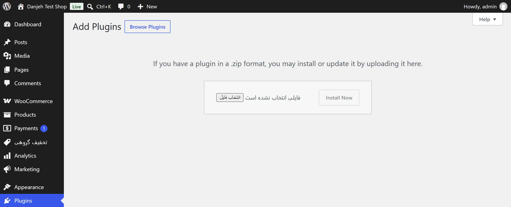

**ZIP کل مخزن گیت‌هاب بستهٔ نصب وردپرس نیست.** برای نصب از فایل داخل `dist/` استفاده کنید. Node.js، Composer و Docker فقط برای توسعه و تست لازم‌اند؛ کاربر نهایی به آن‌ها نیاز ندارد.

### روش دوم: نصب پوشهٔ افزونه

پوشهٔ `smart-bulk-discount/` را با تمام محتویاتش، از جمله `build/`، در مسیر `wp-content/plugins/` قرار دهید و افزونه را از پیشخوان فعال کنید.

اگر نسخه‌ای با نام پوشهٔ قدیمی دارید، دو نسخه را هم‌زمان فعال نکنید. پیش از تعویض نسخه، کمپین‌های در حال اجرا را تمام کنید و منتظر بازگردانی قیمت‌ها بمانید. داده‌ها به‌صورت پیش‌فرض هنگام حذف نگه داشته می‌شوند، مگر اینکه حذف داده‌ها را در تنظیمات فعال کرده باشید.

<a id="walkthrough"></a>

## آموزش تصویری ساخت کمپین

### ۱. نوع و مقدار تخفیف

از صفحهٔ اصلی **«تخفیف جدید»** یا یکی از سناریوهای آماده را انتخاب کنید. نوع درصدی یا مبلغ ثابت، مقدار و نام کمپین را وارد کنید. بخش تنظیمات بیشتر شامل رفتار با تخفیف قبلی، گرد کردن قیمت و کمترین قیمت مجاز است.

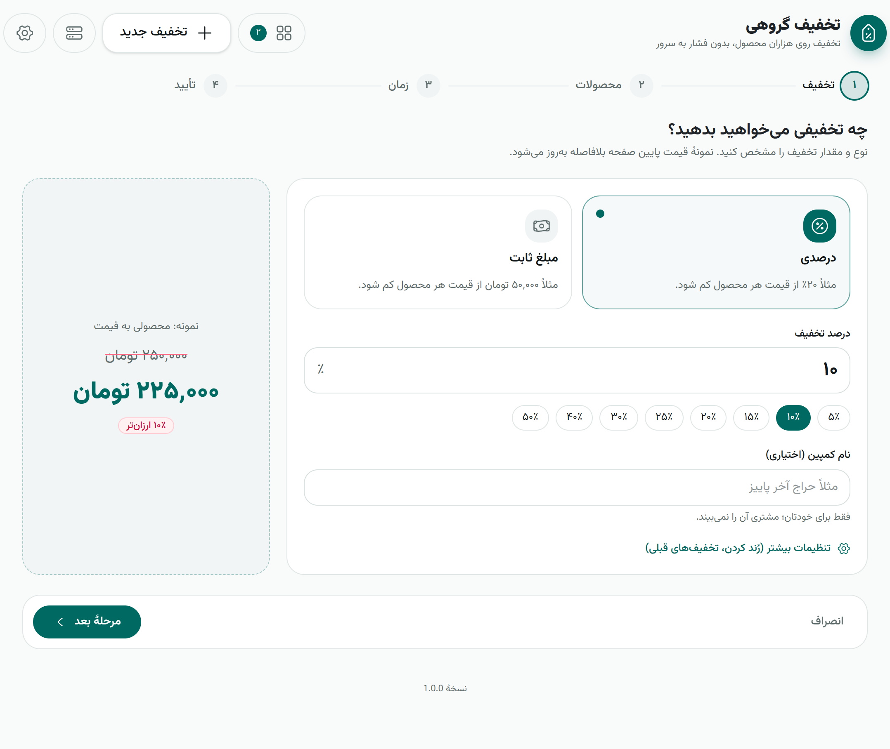

### ۲. انتخاب محصولات

یکی از حالت‌های **همهٔ موجودها**، **دسته‌بندی‌ها** یا **محصولات دلخواه** را انتخاب کنید. در حالت دسته‌بندی، زیرمجموعه‌ها و استثناها را بررسی کنید؛ در حالت انتخابی، محصولات را با چند جستجوی جداگانه به سبد اضافه کنید. تعداد تنوع‌های محصول متغیر جداگانه محاسبه می‌شود.

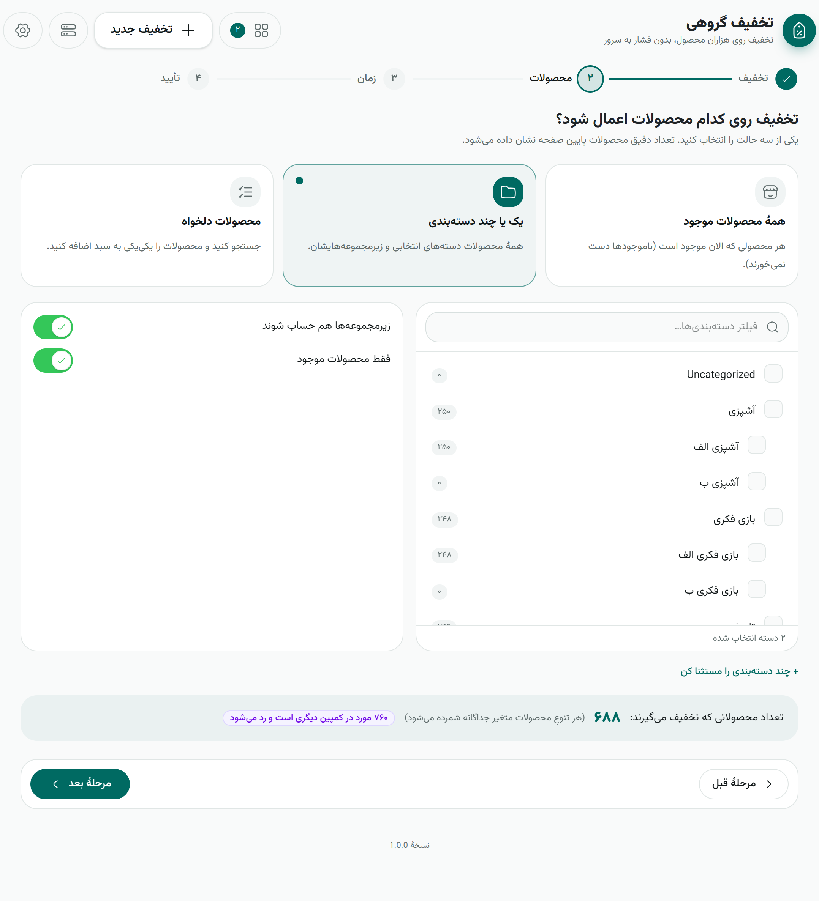

<details>
<summary>تصاویر انتخاب محصولات دلخواه و همهٔ موجودها</summary>

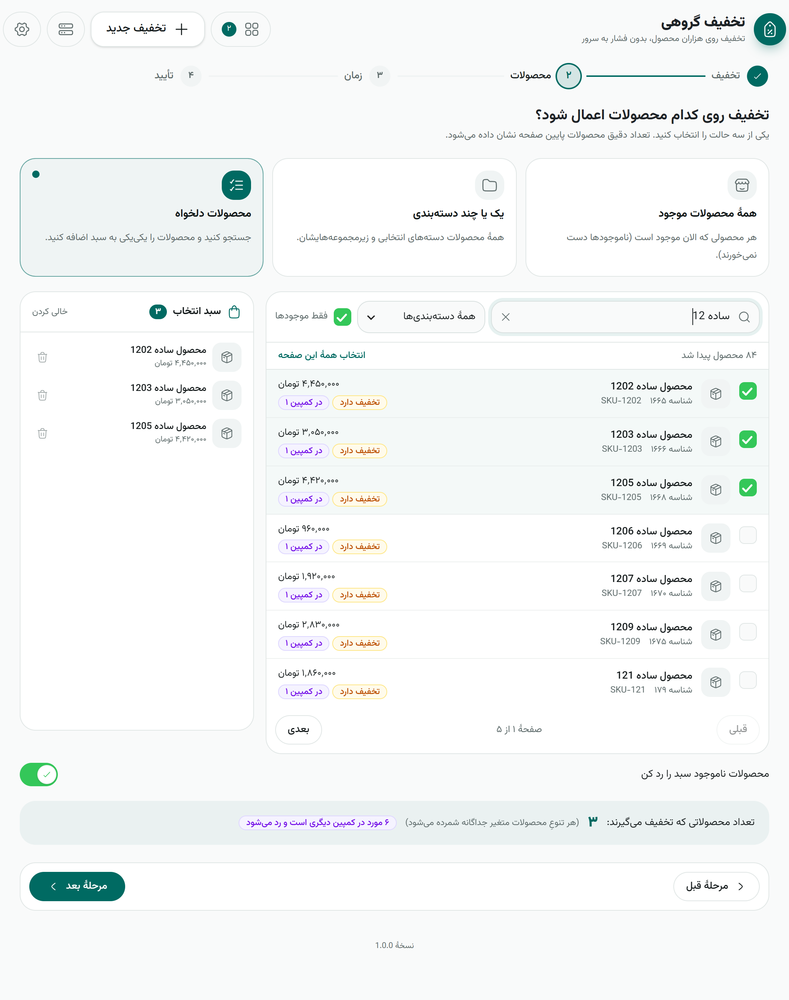

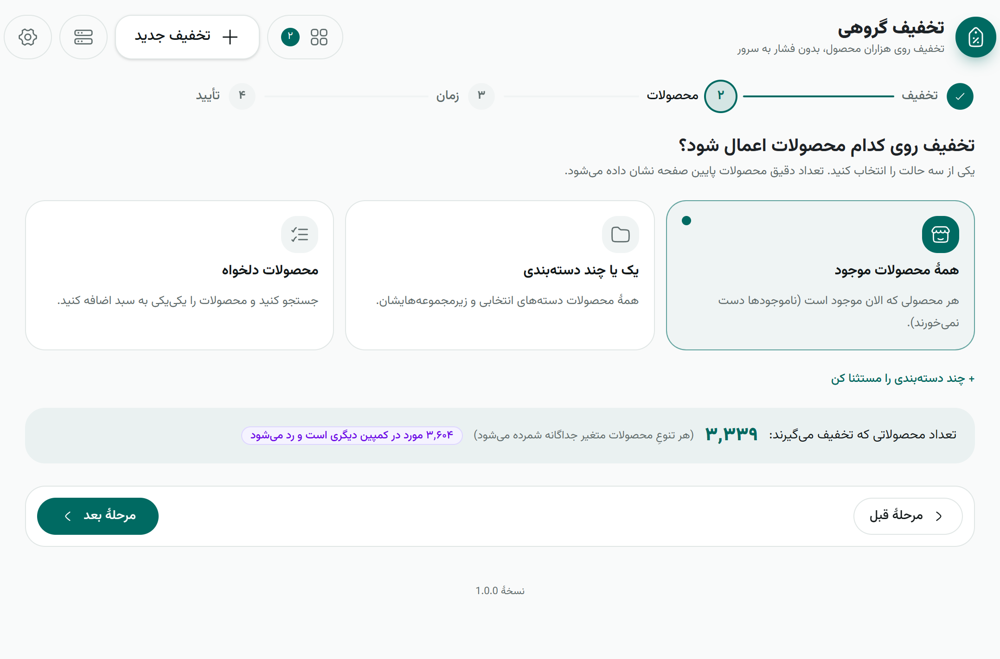

</details>

### ۳. زمان شروع و پایان

شروع فوری، بازهٔ مشخص یا تکرار روزانه/هفتگی را تعیین کنید. تاریخ در پنل شمسی است و ساعت بر اساس **منطقهٔ زمانی سایت در تنظیمات وردپرس** تفسیر می‌شود. زمان مرورگر کاربر مبنا نیست؛ برای فروشگاه ایرانی، منطقهٔ زمانی سایت را بررسی کنید.

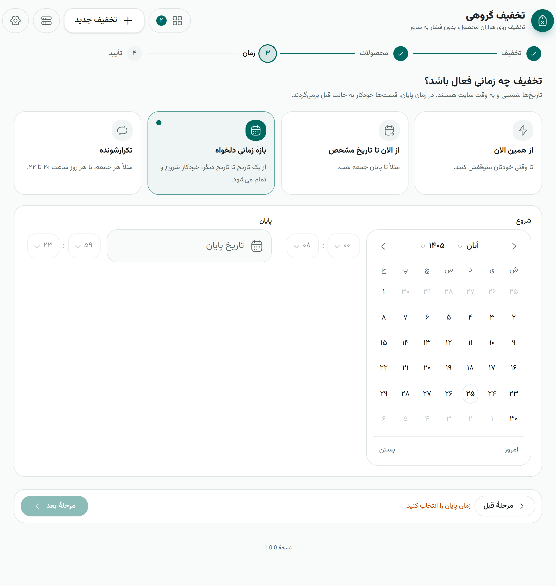

### ۴. بررسی و اجرا

خلاصهٔ تخفیف، محصولات، زمان‌ها و نمونهٔ قیمت را بررسی کنید؛ سپس کمپین را به‌صورت پیش‌نویس ذخیره کنید یا اجرا کنید. اجرای کمپین صف پردازش را راه می‌اندازد؛ تغییر هزاران قیمت در یک درخواست انجام نمی‌شود.

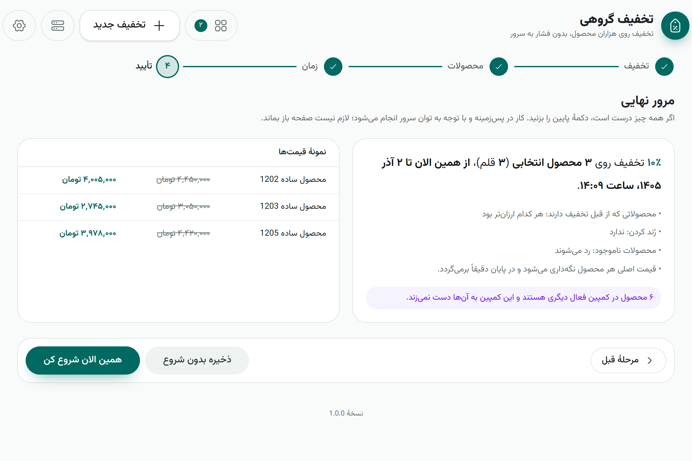

### ۵. پیگیری نتیجه

در جزئیات کمپین، پیشرفت، قیمت قبلی و جدید هر محصول و علت رد شدن یا خطا را ببینید. اگر نتیجه با انتظار شما فرق داشت، فیلتر موارد ردشده و خطادار را بررسی کنید.

**گزارش کمپین:** در کادر «محصولات کمپین» دو دکمه هست:

- **خروجی اکسل** یک فایل `.xlsx` دانلود می‌کند. برگهٔ «محصولات» برای هر محصول ردیف، شناسه، کد (SKU)، نام، لینک محصول در فروشگاه، قیمت عادی، قیمت قبلی (اگر محصول فروش ویژهٔ خودش را داشت، همان)، قیمت جدید کمپین، مبلغ و درصد تخفیف و وضعیت را دارد. برگهٔ «خلاصه» مشخصات کمپین را دارد.
- **خروجی PDF** همین گزارش را در پنجرهٔ چاپ مرورگر باز می‌کند. در آن پنجره مقصد را «Save as PDF» بگذارید. این روش متن فارسی را دقیق و قابل جستجو نگه می‌دارد.

قیمت‌ها از نسخهٔ پشتیبانی خوانده می‌شوند که پیش از اولین تغییر گرفته شده است؛ پس گزارش بعد از پایان کمپین و بازگشت قیمت‌ها هم درست است. گزارش برای هزاران محصول صفحه‌به‌صفحه آماده می‌شود و فشاری به سرور نمی‌آورد.

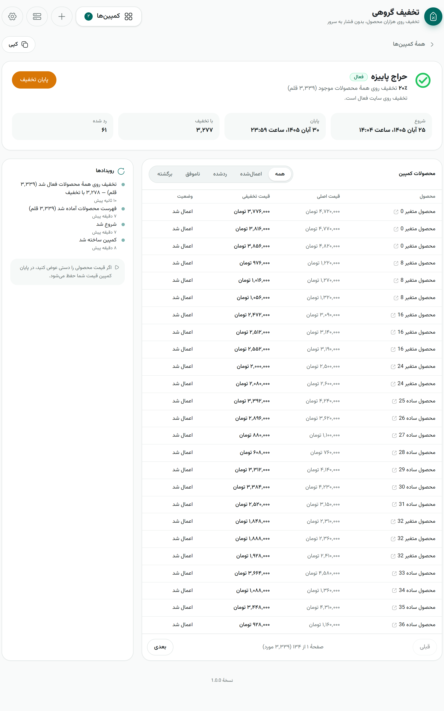

<details>
<summary>تصاویر اجرای کمپین و زمان‌بندی آینده</summary>

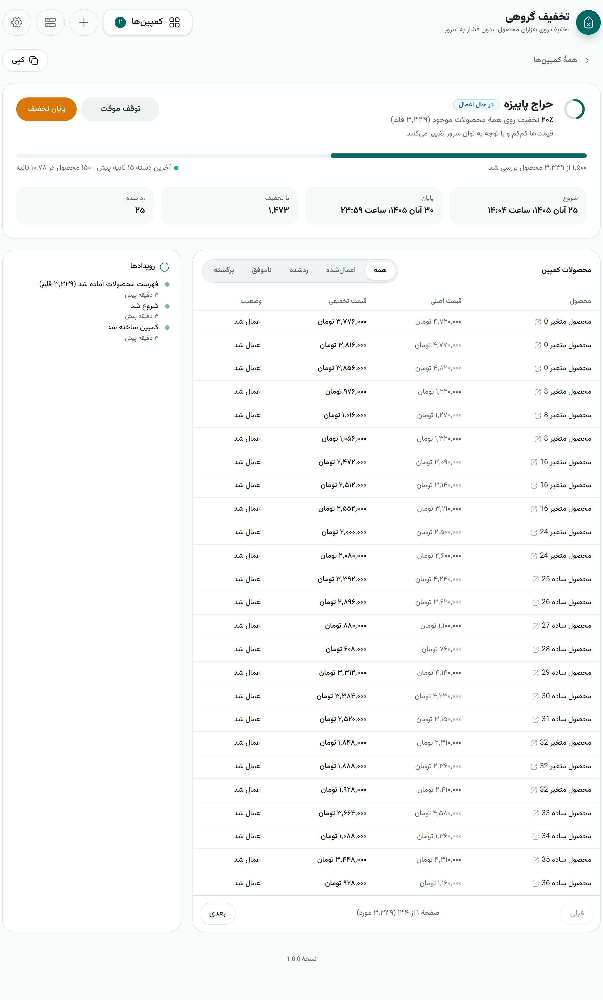

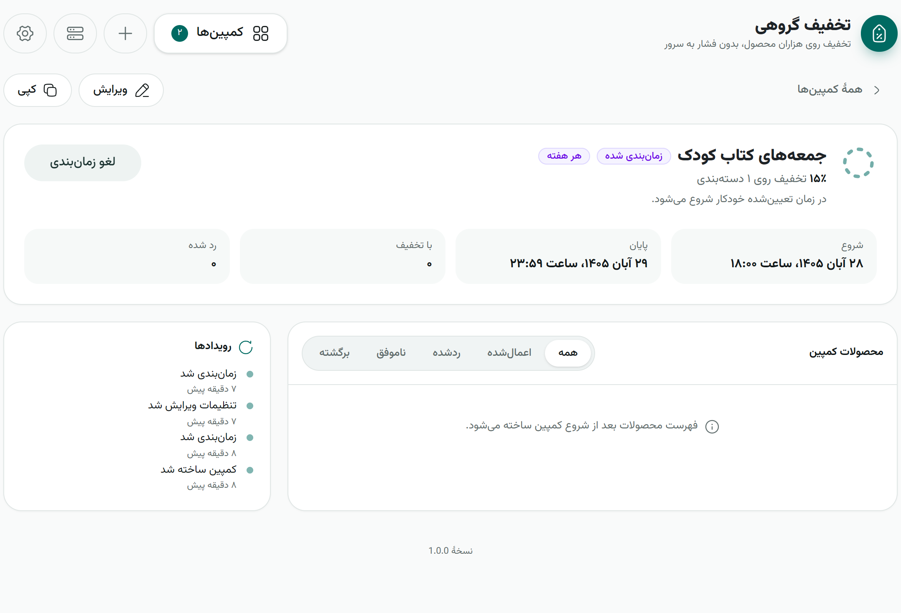

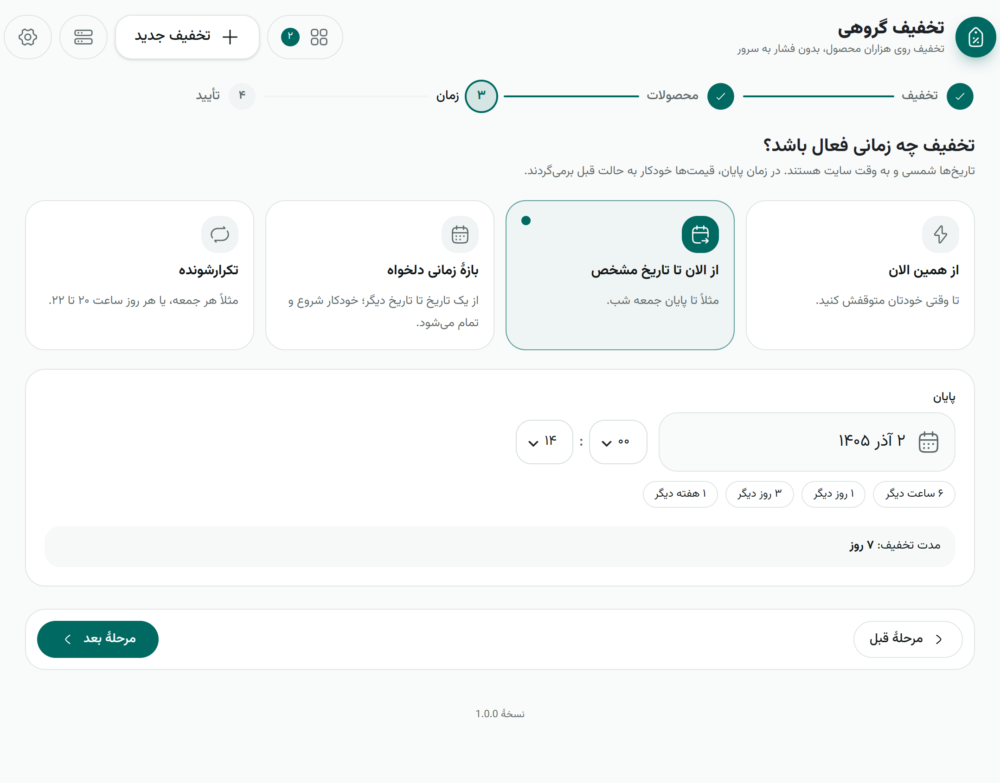

</details>

<a id="campaigns"></a>

## وضعیت‌ها و مدیریت کمپین

| وضعیت | معنی |
| --- | --- |
| پیش‌نویس (`draft`) | تنظیمات ذخیره شده، هنوز اجرایی شروع نشده است |
| زمان‌بندی‌شده (`scheduled`) | منتظر شروع بازه یا دورهٔ بعد است |
| آماده‌سازی (`preparing`) | محصولات واجد شرایط وارد صف می‌شوند |
| اعمال (`applying`) | قیمت‌های قبلی ذخیره و فروش ویژه ثبت می‌شود |
| بررسی (`verifying`) | قیمت‌های ثبت‌شده دوباره از پایگاه داده کنترل می‌شوند |
| فعال (`active`) | مرحلهٔ پردازش و بررسی تمام شده؛ آمار موارد ردشده و خطادار همچنان باید بررسی شود |
| توقف موقت (`paused`) | پردازش متوقف است؛ زمان پایان کمپین همچنان اهمیت دارد |
| بازگردانی (`reverting`) | قیمت‌های تحت مدیریت کمپین به حالت قبل برمی‌گردند |
| بررسی بازگردانی (`verifying_revert`) | نتیجهٔ بازگردانی کنترل می‌شود |
| تمام‌شده (`ended`) | چرخه تمام شده است؛ نتیجهٔ هر محصول در جزئیات قابل مشاهده است |

- **توقف موقت / ادامه:** پردازش را متوقف یا از همان نقطه ادامه می‌دهد. توقف موقت، پایان دادن به تخفیف نیست.
- **پایان تخفیف:** بازگردانی قیمت‌ها را شروع می‌کند؛ تا پایان فرایند صبر کنید.
- **لغو زمان‌بندی:** کمپین منتظر شروع را به پیش‌نویس برمی‌گرداند.
- **ویرایش:** برای کمپین پیش‌نویس، زمان‌بندی‌شده یا تمام‌شده در دسترس است.
- **کپی:** یک پیش‌نویس از تنظیمات کمپین می‌سازد.
- **تلاش دوباره:** موارد خطادار را برای پردازش مجدد وارد صف می‌کند.
- **حذف:** برای کمپین‌های مجاز، همراه با فرصت انصراف از طریق شمارش معکوس انجام می‌شود.

<a id="pricing"></a>

## محاسبه و بازگردانی قیمت‌ها

تخفیف از **قیمت عادی محصول** محاسبه می‌شود، سپس سیاست انتخابی دربارهٔ فروش ویژهٔ قبلی تصمیم می‌گیرد. مبلغ ثابت نیز در واحد پول فروشگاه است؛ مثال‌های تومان فقط برای فروشگاهی با همین واحد معتبرند.

| قیمت عادی | تنظیم | نتیجه |
| --- | --- | --- |
| ۲۵۰٬۰۰۰ | تخفیف ۲۰٪ | ۲۰۰٬۰۰۰ |
| ۲۵۰٬۰۰۰ | تخفیف ثابت ۵۰٬۰۰۰ | ۲۰۰٬۰۰۰ |
| ۱۰۹٬۹۰۰ | تخفیف ۱۵٪ و گرد کردن به ۱٬۰۰۰ | ۹۳٬۰۰۰ |

گرد کردن همیشه **به پایین** است. گزینه‌های پنل: بدون گرد کردن، ۱۰۰، ۱٬۰۰۰، ۵٬۰۰۰ و ۱۰٬۰۰۰. قیمتی که صفر، منفی، بدون کاهش واقعی یا کمتر از حداقل تعیین‌شده باشد اعمال نمی‌شود.

### رفتار با تخفیف‌های قبلی

| سیاست | نتیجه |
| --- | --- |
| هرکدام ارزان‌تر (`best`) | اگر فروش ویژهٔ موجود ارزان‌تر یا مساوی باشد، محصول دست‌نخورده می‌ماند |
| جایگزینی (`override`) | تخفیف کمپین جایگزین می‌شود و اطلاعات قبلی برای پایان ذخیره می‌شود |
| دست نزن (`keep`) | محصولی که فروش ویژهٔ معتبر دارد رد می‌شود |

### حفاظت از اطلاعات قیمت

- اطلاعات قیمت و زمان‌های فروش ویژهٔ قبلی، **پیش از اولین تغییر** در جدول آیتم‌ها ذخیره می‌شود.
- پیشرفت هر محصول در پایگاه داده ثبت می‌شود تا اجرای مجدد پس از قطع پردازش ممکن باشد.
- قیمت‌ها پس از اعمال و بازگردانی از پایگاه داده خوانده و کنترل می‌شوند؛ موارد ناسازگار سقف تلاش مجدد دارند.
- بازگردانی بررسی می‌کند قیمت هنوز متعلق به کمپین باشد؛ تغییر دستیِ متفاوت در قیمت فروش ویژه حفظ می‌شود.
- محصول تحت مدیریت یک کمپین زنده، در کمپین دیگر بازنویسی نمی‌شود؛ کمپین دوم آن را رد می‌کند.
- `PriceGuard` پس از پایان بازه، نمایش تخفیف منقضی‌شده را در مسیرهای قیمت ووکامرس و سبد خرید محدود می‌کند، حتی اگر بازگردانی فیزیکی همهٔ ردیف‌ها هنوز تمام نشده باشد.

**قبل از غیرفعال یا حذف کردن افزونه، کمپین‌های زنده را تمام کنید و بازگشت قیمت‌ها را بررسی کنید.** غیرفعال‌سازی فقط زمان‌بندها را متوقف می‌کند و خودش قیمت‌ها را برنمی‌گرداند. نسخهٔ پشتیبان قیمت‌ها جای بکاپ کامل سایت را نمی‌گیرد.

<a id="background"></a>

## اجرای پس‌زمینه، زمان‌بندی و کش

### مدیریت منابع هاست

موتور، زمان و حافظه را بین محصولات کنترل می‌کند و بین عملیات استراحت می‌گذارد. کند شدن ذخیرهٔ محصولات و فشار حافظه باعث کاهش اندازهٔ دسته و افزایش فاصلهٔ اجرا می‌شود. عدد بار پردازنده یکی از علائم تنظیم سرعت است و به‌تنهایی کار را برای همیشه متوقف نمی‌کند.

| پروفایل | سقف زمانی پایهٔ دسته | سقف تعداد پایه | سهم هدف از زمان کار/استراحت |
| --- | --- | --- | --- |
| ملایم (`gentle`) | ۵ ثانیه | ۴۰ محصول | حدود ۳۰٪ کار |
| خودکار (`auto`) | ۱۰ ثانیه | ۱۲۰ محصول | حدود ۵۰٪ کار |
| سریع (`fast`) | ۲۵ ثانیه | ۴۰۰ محصول | حدود ۸۵٪ کار |

این‌ها سقف‌ها و اهداف تنظیمات موتورند؛ بودجهٔ واقعی بر اساس محدودیت PHP و وضعیت میزبان پایین‌تر می‌آید. این اعداد درصد مصرف واقعی CPU نیستند و زمان اتمام یا نبود خطای سرور را روی هر هاستی تضمین نمی‌کنند.

### چه چیزی صف را جلو می‌برد؟

درخواست داخلی سایت به خودش، Action Scheduler ووکامرس یا WP-Cron، و کمک صفحهٔ باز مدیریت مسیرهای اجرا هستند. قفل سراسری از اجرای هم‌زمان چند نویسنده جلوگیری می‌کند. نگهبان دوره‌ای برای بازیابی کار متوقف‌شده طراحی شده است؛ اجرای به‌موقع آن به در دسترس بودن زمان‌بند بستگی دارد.

برای فروشگاه کم‌بازدید یا زمان‌بندی شبانه، کران واقعی هاست را فعال کنید. نمونهٔ درخواست هر دقیقه؛ دامنه را عوض کنید:

</div>

```cron
* * * * * curl -fsS "https://example.com/wp-cron.php?doing_wp_cron" >/dev/null 2>&1
```

<div dir="rtl" align="right">

فقط بعد از راه‌اندازی و بررسی کران واقعی، در صورت نیاز `DISABLE_WP_CRON` را در `wp-config.php` فعال کنید. زمان‌های داخلی UTC هستند؛ تبدیل ساعت سایت از کلاس `Clock` می‌گذرد تا فیلترهای افزونه‌های تاریخ فارسی روی ذخیره‌سازی اثر نگذارند.

### سازگاری با کش صفحه

`CacheCompat` هنگام پردازش دسته‌ای، برخی پاک‌سازی‌های تک‌محصولیِ افزونه‌های شناخته‌شده را موقتاً مهار می‌کند و در گذارهای اصلی کمپین پاک‌سازی انجام می‌دهد: فعال شدن تخفیف، شروع پایان و اتمام بازگردانی. در کمپین تکرارشونده این رفتار برای هر چرخه تکرار می‌شود.

کد اتصال برای WP Rocket، LiteSpeed Cache، W3 Total Cache، WP Super Cache، WP Fastest Cache، SiteGround Optimizer، Breeze، Hummingbird، Cache Enabler، WP-Optimize، Swift Performance، Comet Cache، Nginx Helper و Cloudflare وجود دارد. وجود اتصال به معنی آزمون همهٔ نسخه‌ها و تنظیمات آن خدمات نیست. گزینهٔ «سازگاری با افزونه‌های کش» قابل خاموش کردن است و اکشن `dsd_purge_page_cache` برای اتصال سفارشی در دسترس است.

<a id="troubleshooting"></a>

## تنظیمات و عیب‌یابی

در **سلامت سرور**، حافظه و محدودیت زمان PHP، آخرین فعالیت، اندازهٔ دسته، زمان پردازش محصولات، وقفه‌ها و وضعیت مسیرهای اجرا را ببینید. برای هاست اشتراکی از خودکار شروع کنید و در صورت نیاز ملایم را انتخاب کنید.

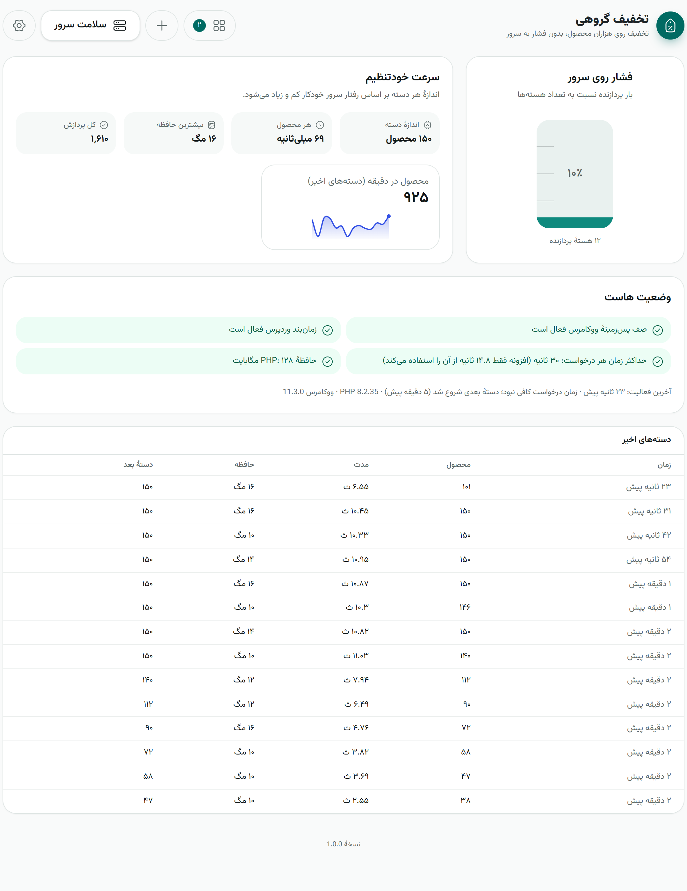

<details>
<summary>تصویر تنظیمات افزونه</summary>

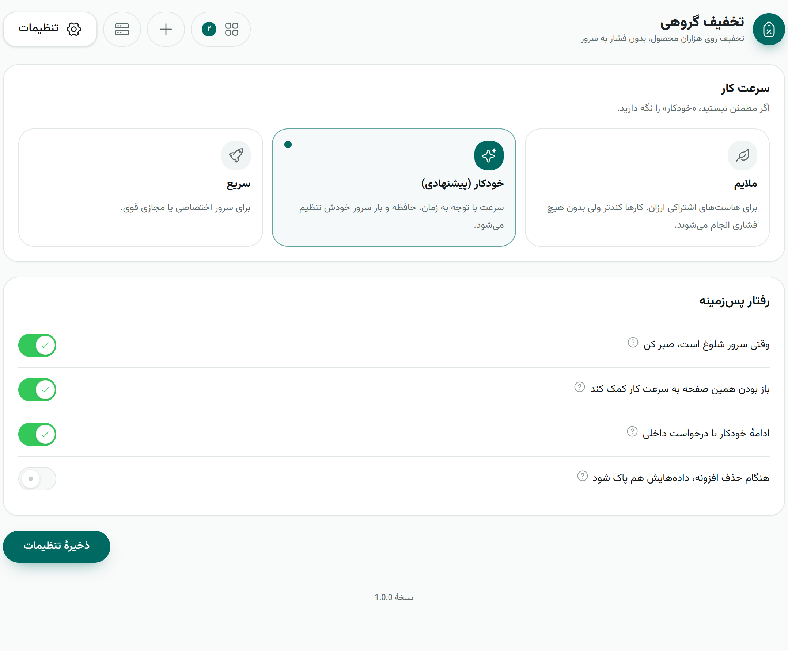

</details>

| مسئله | بررسی پیشنهادی |
| --- | --- |
| منوی افزونه دیده نمی‌شود | فعال بودن ووکامرس و مجوز `manage_woocommerce` کاربر را بررسی کنید |
| محصول تخفیف نگرفته | علت مورد ردشده/خطادار، موجودی، قیمت عادی، تخفیف قبلی و کمپین هم‌پوشان را ببینید |
| کمپین کند پیش می‌رود | آخرین فعالیت و وقفهٔ خنک‌سازی را در سلامت سرور ببینید؛ پروفایل و محدودیت میزبان مؤثرند |
| پردازش جلو نمی‌رود | WP-Cron، Action Scheduler، مسدود نبودن درخواست داخلی و خطای افزونه‌های دیگر را بررسی کنید؛ صفحهٔ مدیریت می‌تواند به اجرای صف کمک کند |
| ساعت کمپین اشتباه است | منطقهٔ زمانی سایت را بررسی کنید؛ API ورودی تاریخ میلادی با ساعت محلی سایت می‌گیرد |
| صفحهٔ فروشگاه قیمت قدیمی دارد | ابتدا قیمت واقعی و وضعیت کمپین، سپس کش صفحه، کش CDN و تنظیمات اتصال کش را بررسی کنید |
| قیمت عادی بعد از کمپین برابر قیمت تخفیفی شده | افزونه قیمت عادی را هرگز نمی‌نویسد؛ معمولاً یک برنامهٔ همگام‌سازی قیمت مقصر است. با کوئری فقط‌خواندنی [diagnose-regular-price.sql](docs/diagnose-regular-price.sql) بررسی کنید؛ گزارش کامل در [regular-price-investigation.md](docs/regular-price-investigation.md) است |
| تعداد بیشتر از تعداد محصولات است | هر تنوع محصول متغیر یک آیتم قیمت‌دار جداگانه است |
| قصد حذف کامل دارید | همهٔ کمپین‌ها را تمام کنید؛ سپس «حذف داده‌ها هنگام حذف افزونه» را فعال و افزونه را حذف کنید |

داده‌ها به‌صورت پیش‌فرض حفظ می‌شوند. پاک‌سازی اختیاری نیز اگر کمپین‌هایی با احتمال داشتن قیمت تحت مدیریت وجود داشته باشد، جدول بکاپ را حذف نمی‌کند. افزونهٔ دیگری که هم‌زمان قیمت همین محصولات را بازنویسی می‌کند ممکن است نتیجه را تغییر دهد؛ آمار بررسی نهایی را کنترل کنید.

<a id="architecture"></a>

## ساختار و معماری پروژه

</div>

```text
Discount-Plugin/
├── smart-bulk-discount/       # افزونهٔ قابل نصب: PHP و خروجی آمادهٔ پنل
│   ├── smart-bulk-discount.php
│   ├── includes/             # موتور، زمان‌بند، قیمت‌ها، API و مدیریت
│   ├── build/                # index.js و index.css آمادهٔ انتشار
│   ├── readme.txt
│   └── uninstall.php
├── admin-app/                # سورس React، TypeScript و Tailwind
│   ├── src/app/              # صفحات، فرم ساخت کمپین و انتخاب محصولات
│   ├── src/components/       # اجزای رابط کاربری
│   ├── src/lib/              # API، تاریخ، نوع داده و ابزارهای مشترک
│   └── scripts/scope-css.mjs # محدود کردن CSS به پنل افزونه
├── tests/unit/               # تست‌های مستقل PHP
├── tests/integration/        # سناریوهای واقعی WooCommerce و شبیه‌ساز هاست
├── docker/                   # محیط محلی، ساخت بسته و اجرای تست‌ها
├── dist/                     # ZIP آمادهٔ نصب وردپرس
├── docs/                     # PDF، HTML، فونت و تصاویر راهنما
├── graphify-out/             # نقشهٔ تعاملی، داده و گزارش ساختار کد
├── Codes/Discount/.claude/    # راهنماها و ابزارهای توسعهٔ همراه پروژه
├── composer.json / composer.lock
├── phpunit.xml.dist
└── CLAUDE.md                 # قواعد و محدودیت‌های توسعه
```

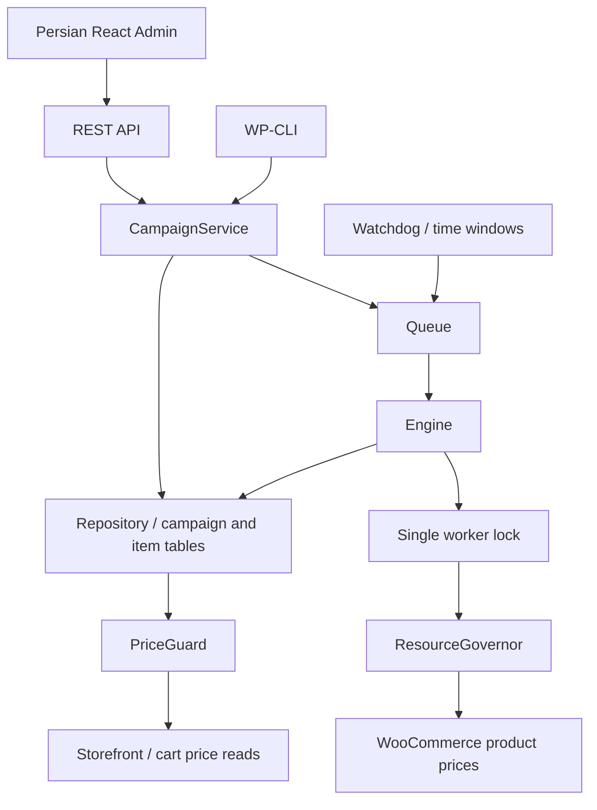

<div dir="rtl" align="right">

### نقش بخش‌های اصلی

| کلاس یا بخش | مسئولیت |
| --- | --- |
| `CampaignService` | اعتبارسنجی و فرمان‌های مشترک API و CLI |
| `Repository` | ذخیره و بازیابی کمپین‌ها، آیتم‌ها، آمار و رویدادها |
| `TargetResolver` | یافتن محصولات واجد شرایط در قطعه‌های محدود |
| `Engine` | آماده‌سازی، اعمال، بررسی، بازگردانی و بررسی بازگردانی |
| `ResourceGovernor` | محدودیت زمان و حافظه، اندازهٔ دسته و استراحت |
| `Queue` / `Watchdog` / `Lock` | مسیرهای اجرا، گذار زمانی، بازیابی و جلوگیری از نویسندهٔ هم‌زمان |
| `PriceCalculator` | منطق مستقل محاسبه و سیاست قیمت |
| `PriceGuard` | کنترل قیمت قابل نمایش پس از پایان بازه |
| `Clock` / `Schedule` | تبدیل زمان و محاسبهٔ پنجره‌های اجرا |
| `CacheCompat` | هماهنگی پردازش دسته‌ای با کش صفحه |

دو جدول اختصاصی با پیشوند نصب وردپرس ایجاد می‌شوند: `{prefix}dsd_campaigns` و `{prefix}dsd_items`. متای `_dsd_campaign` برای مالکیت قیمت محصول استفاده می‌شود. نام‌های `dsd_` برای سازگاری با نصب‌های قبلی حفظ شده‌اند؛ فضای نام PHP برابر `SmartBulkDiscount` است.

پنل با React، TypeScript، Tailwind و Vite ساخته می‌شود. خروجی JS از نوع IIFE است و CSS پس از ساخت به `#dsd-root` محدود می‌شود تا استایل پیشخوان را تغییر ندهد. فونت وزیرمتن در خروجی پنل قرار دارد.

برای مطالعهٔ بیشتر: [قواعد پروژه](CLAUDE.md)، [راهنمای موتور](Codes/Discount/.claude/skills/dsd-campaign-engine/SKILL.md)، [راهنمای پنل](Codes/Discount/.claude/skills/dsd-admin-ui/SKILL.md)، [راهنمای تست](Codes/Discount/.claude/skills/dsd-testing/SKILL.md) و [گزارش نقشهٔ کد](graphify-out/GRAPH_REPORT.md). فایل `graphify-out/graph.html` را پس از دانلود می‌توان محلی باز کرد؛ نمودار روابط، جایگزین بررسی کد جاری نیست.

<a id="development"></a>

## راه‌اندازی محیط توسعه و تست

### ابزارهای موردنیاز توسعه‌دهنده

- Git، Composer 2 و PHP سازگار با PHPUnit 9.6 برای تست واحد.
- Node.js سازگار با وابستگی‌های قفل‌شده؛ برای مجموعهٔ فعلی از `22.22.2+` در شاخهٔ ۲۲، `24.15.0+` در شاخهٔ ۲۴ یا `26+` استفاده کنید.
- Python 3 برای سناریوهای یکپارچه و ساخت ZIP.
- Docker و Docker Compose v2 برای محیط واقعی WordPress، WooCommerce و MariaDB.

### دریافت سورس و نصب وابستگی‌ها

</div>

```bash
git clone https://github.com/hoomanjamshidi/Discount-Plugin.git
cd Discount-Plugin
composer install
cd admin-app
npm ci
npm run build
cd ..
```

<div dir="rtl" align="right">

پوشه‌های `node_modules/` و `vendor/` در مخزن قرار نمی‌گیرند؛ وابستگی‌ها با فایل‌های قفل‌شده دوباره نصب می‌شوند. خروجی `smart-bulk-discount/build/` و ZIP نصب در مخزن هستند تا نصب نهایی نیاز به ابزار توسعه نداشته باشد.

### محیط آزمایشی ووکامرس

</div>

```bash
docker compose -f docker/docker-compose.yml up -d
bash docker/setup.sh
bash docker/seed.sh 3000
```

<div dir="rtl" align="right">

آدرس پیشخوان: `http://localhost:8088/wp-admin/` · نام کاربری: `admin` · رمز: `admin`.

این اطلاعات مخصوص محیط محلی آزمایشی است. پشتهٔ Docker با حافظهٔ PHP برابر ۱۲۸ مگابایت و سقف اجرای ۳۰ ثانیه تنظیم شده است. نصب اولیهٔ WooCommerce به اینترنت نیاز دارد و تولید ۳۰۰۰ محصول زمان‌بر است.

**سناریوهای یکپارچه پایگاه دادهٔ محیط آزمایشی را از snapshot بازسازی می‌کنند.** آن‌ها را فقط روی همین محیط تست اجرا کنید. دادهٔ نمونه و شبیه‌ساز هاست برای فروشگاه واقعی نیستند.

### اجرای بررسی‌ها

</div>

```bash
# PHP unit tests; no WordPress needed
composer test:unit

# Admin tests, type checking and production build
cd admin-app
npm test
npm run typecheck
npm run build
cd ..

# Full suite after Docker setup and seeding
bash docker/run-tests.sh

# Selected integration scenarios
python3 tests/integration/run.py s05 s11
```

<div dir="rtl" align="right">

| لایه | پوشش |
| --- | --- |
| PHP unit | محاسبهٔ قیمت، ساعت و زمان‌بندی، کنترل منابع و اتصال کش |
| Vitest | قالب تاریخ، اعداد فارسی، فرم، تقویم و رفتار دکمه‌ها |
| سناریوهای `s01` تا `s10` | دامنهٔ تخفیف، هم‌پوشانی، قطع پردازش، زمان‌بندی، ویرایش دستی، تکرار و توقف |
| `s11` و `s12` | اجرای وب زیر ترافیک و کمک صفحهٔ مدیریت |
| `s13` تا `s17` | بازیابی بکاپ قبلی، هاست سخت، درخواست داخلی مسدود، خطای افزونهٔ دیگر و تاریخ فارسی |
| `s18` و `s19` | مهار پاک‌سازی انبوه کش و سناریوی WP Rocket واقعی |

سناریوی `s19` بستهٔ جداگانهٔ افزونهٔ شخص ثالث را لازم دارد؛ مسیر و رفتار آن را در `tests/integration/run.py` ببینید. بستهٔ آن افزونه در این مخزن توزیع نمی‌شود. گزارش اجرای یکپارچه در `tests/integration/.out/report.json` ساخته می‌شود و جزو فایل‌های قابل انتشار نیست.

**دامنهٔ اعتبارسنجی این انتشار:** نتایج بررسی‌های فعلی و موارد اجرا‌نشده در [گزارش اعتبارسنجی](docs/VALIDATION.md) ثبت می‌شوند. وجود سناریو یا نتیجهٔ قدیمی در فایل‌های محلی به معنی پاس شدن آن روی نسخهٔ فعلی و همهٔ میزبان‌ها نیست.

<a id="api"></a>

## راهنمای WP-CLI و REST API

### فرمان‌های WP-CLI

این فرمان‌ها را در ریشهٔ نصب وردپرس اجرا کنید یا مسیر نصب را با `--path` مشخص کنید:

</div>

```bash
wp dsd list
wp dsd list --format=json
wp dsd status 12
wp dsd campaign start 12
wp dsd campaign pause 12
wp dsd campaign resume 12
wp dsd campaign stop 12
wp dsd campaign retry 12
wp dsd campaign duplicate 12
wp dsd run --max-batches=10 --budget=5
wp dsd watchdog
```

<div dir="rtl" align="right">

نمونهٔ ساخت پیش‌نویس تخفیف ۲۰ درصد روی موجودها؛ برای اجرا `--start` را اضافه کنید:

</div>

```bash
wp dsd create '{"name":"Store sale","discount_type":"percent","discount_value":20,"target_type":"all_in_stock","options":{"sale_policy":"best","round_step":1000},"repeat_mode":"none"}'
```

<div dir="rtl" align="right">

شناسهٔ `12` نمونه است. پایان دادن از CLI نیز فقط بازگردانی را آغاز می‌کند؛ نتیجه را با وضعیت کمپین کنترل کنید. گزینهٔ `--no-rest` در runner فاصلهٔ استراحت را حذف می‌کند و برای سرور دارای بازدیدکننده مناسب نیست.

### API مدیریتی

ریشهٔ API برابر `/wp-json/dsd/v1` است. تمام مسیرهای زیر مجوز `manage_woocommerce` می‌خواهند. پنل از نشست وردپرس و nonce استاندارد REST استفاده می‌کند؛ این API عمومی یا ناشناس نیست.

| روش | مسیر نسبت به ریشه | کاربرد |
| --- | --- | --- |
| `GET`, `POST` | `/campaigns` | فهرست یا ساخت کمپین |
| `GET`, `POST/PUT/PATCH`, `DELETE` | `/campaigns/{id}` | جزئیات، ویرایش یا حذف |
| `POST` | `/campaigns/{id}/{command}` | `start`, `pause`, `resume`, `stop`, `retry`, `duplicate` |
| `GET` | `/campaigns/{id}/items` | آیتم‌ها با فیلتر وضعیت و صفحه‌بندی |
| `GET` | `/campaigns/{id}/report` | گزارش کامل کمپین برای خروجی اکسل و PDF؛ صفحه‌بندی با `after` و `per_page` (حداکثر ۵۰۰) |
| `POST` | `/preview` | پیش‌نمایش تعداد، تداخل و نمونهٔ قیمت |
| `GET` | `/products`, `/categories` | جستجو و انتخاب دامنهٔ محصولات |
| `GET` | `/system` | وضعیت منابع و موتور |
| `POST` | `/tick` | درخواست اجرای یک دستهٔ کنترل‌شده |
| `GET`, `POST/PUT/PATCH` | `/settings` | خواندن یا ذخیرهٔ تنظیمات |

برای بدنهٔ کمپین، نوع `CampaignInput` در `admin-app/src/lib/types.ts` و اعتبارسنجی `CampaignService::from_input()` را ببینید. **تاریخ ورودی API شمسی نیست:** رشتهٔ میلادی `YYYY-MM-DD HH:mm` با ساعت محلی سایت یا `null` ارسال کنید. نمایش شمسی در پنل انجام می‌شود.

<a id="distribution"></a>

## ساخت بسته، مشارکت و مجوز

### ساخت ZIP نصب

بعد از نصب وابستگی‌ها در ریشهٔ مخزن اجرا کنید:

</div>

```bash
bash docker/package.sh
```

<div dir="rtl" align="right">

این دستور پنل را می‌سازد و فقط پوشهٔ افزونه را در `dist/smart-bulk-discount-<version>.zip` بسته‌بندی می‌کند. شمارهٔ فایل از سربرگ PHP خوانده می‌شود. هنگام انتشار، نسخهٔ سربرگ، `DSD_VERSION`، `Stable tag` و فایل ZIP را هماهنگ نگه دارید.

### توسعه و گزارش اشکال

ابتدا [CLAUDE.md](CLAUDE.md) و راهنمای بخش مربوطه را بخوانید. نحو PHP 7.4، نام‌های `dsd_`، ذخیرهٔ بکاپ پیش از تغییر، اجرای قابل تکرار، قفل تک‌پردازنده و محدودسازی CSS از قواعد اصلی پروژه‌اند. تغییر موتور باید با تست قیمت و بازگردانی و اجرای مجموعهٔ یکپارچه بررسی شود.

برای [گزارش اشکال](https://github.com/hoomanjamshidi/Discount-Plugin/issues)، نسخهٔ WordPress، WooCommerce و PHP، مراحل بازتولید، وضعیت کمپین و پیام مرتبط سلامت سرور را بنویسید. اطلاعات ورود و دادهٔ شخصی فروشگاه را در گزارش عمومی قرار ندهید.

### مجوز و منابع همراه

مجوز اعلام‌شدهٔ کد پروژه **GNU GPL نسخهٔ ۲ یا نسخه‌های بعدی** است؛ متن در [LICENSE](LICENSE) قرار دارد. استفاده و توسعهٔ مجدد باید با شرایط همین مجوز و مجوز اجزای همراه انجام شود.

- نام سازندهٔ افزونه: **Hooman Jamshidi**.
- اجزای رابط برگرفته از Tarhak/FarsiUI در سورس مشخص شده‌اند؛ توضیحات منبع آن‌ها را حفظ کنید.
- فونت وزیرمتن با مجوز OFL در راهنما همراه است: [متن مجوز فونت](docs/guide/fonts/OFL-Vazirmatn.txt).
- راهنماهای WordPress agent-skills با اعلان مجوز خودشان در `Codes/Discount/.claude/skills/` نگه داشته شده‌اند.
- فهرست نسخه‌های دقیق وابستگی‌های توسعه در `composer.lock` و `admin-app/package-lock.json` موجود است.

آرشیو انتقال اولیهٔ `Codes.zip`، وابستگی‌های نصب‌شده، خروجی تست‌ها و فایل‌های محلی در Git قرار نمی‌گیرند؛ سورس پروژه، فایل‌های قفل وابستگی، خروجی قابل نصب، تصاویر و راهنماها به‌صورت مستقل موجودند.

</div>
